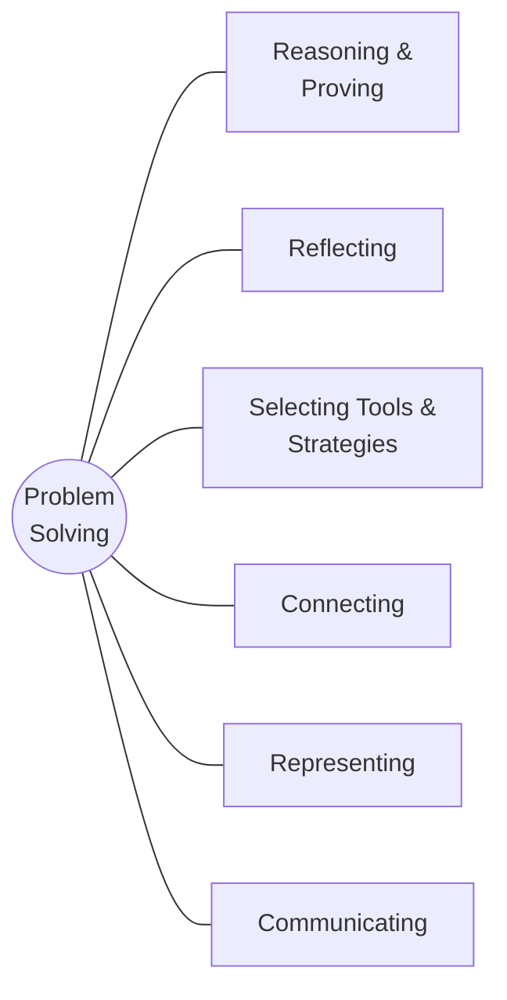

# Chapter 1: Mathematical Processes

> 📖 Textbook pp. 2–37 · [⬅ Course home](../)

Doing math is more than getting answers. This chapter covers the **seven mathematical
processes** you use in every unit. They overlap: each section focuses on one process,
but you will use the others too.

## Sections

| # | Section | Pages | Process in one line |
|---|---------|-------|---------------------|
| 1.1 | [Focus on Problem Solving](1.1-problem-solving/) | 6–9 | Understand → plan → solve → look back |
| 1.2 | [Focus on Communicating](1.2-communicating/) | 10–13 | Explain clearly with words, diagrams and symbols |
| 1.3 | [Focus on Connecting](1.3-connecting/) | 14–18 | Link math to real life and to other areas of math |
| 1.4 | [Focus on Representing](1.4-representing/) | 19–22 | Show a situation as numbers, a diagram, a graph or algebra |
| 1.5 | [Focus on Selecting Tools and Computational Strategies](1.5-selecting-tools/) | 23–28 | Choose the best tool: mental math, calculator, model, computer |
| 1.6 | [Focus on Reasoning and Proving](1.6-reasoning-and-proving/) | 29–33 | Justify conclusions; prove or disprove conjectures |
| 1.7 | [Focus on Reflecting](1.7-reflecting/) | 34–36 | Check your strategy and whether your answer makes sense |

## Vocabulary
natural number · prime number · perfect square · vertex · pentomino · rational number ·
conjecture · mean · counter-example ([full definitions](../GLOSSARY.md))

## Get Ready refresher (pp. 4–5)

**Fractions**
- Add/subtract: use the **lowest common denominator** first.
  e.g. $\frac{3}{4} + \frac{1}{3} = \frac{9}{12} + \frac{4}{12} = \frac{13}{12} = 1\frac{1}{12}$
- Multiply: change mixed numbers to improper fractions, cancel common factors, then multiply across.
- Divide: **multiply by the reciprocal**. $2\frac{1}{3} \div \frac{6}{7} = \frac{7}{3}\times\frac{7}{6} = \frac{49}{18} = 2\frac{13}{18}$

**Integers**
- Add: $-2 + 5 = 3$, $\;2 + (-6) = -4$
- Subtract = add the opposite: $4 - 9 = 4 + (-9) = -5$, $\;2 - (-4) = 2 + 4 = 6$
- Multiply/divide: same signs → positive, different signs → negative.
  $-9 \times (-5) = 45$, $\;20 \div (-4) = -5$

**Order of operations: BEDMAS**
**B**rackets → **E**xponents → **D**ivision and **M**ultiplication (left to right) → **A**ddition and **S**ubtraction (left to right).

$$
\begin{aligned}
-2(15-18) + 7 - 3(4^2+10) &= -2(-3) + 7 - 3(16+10)\\
&= 6 + 7 - 3(26)\\
&= 13 - 78\\
&= -65
\end{aligned}
$$

## Problem-solving strategy toolbox
| Strategy | Use it when… |
|----------|--------------|
| Make an organized list / table | You need to count all possibilities without missing any |
| Look for a pattern | Something repeats or grows step by step |
| Work backward | You know the end result and need the start |
| Draw a diagram | The situation is physical or spatial |
| Use systematic trial (guess & check) | There are a few candidates; adjust each guess logically |
| Use logic or reasoning | Clues eliminate possibilities |
| Solve a simpler problem | Numbers are too big; try small cases first |
| Make a model / act it out | Hands-on helps you see it |
| Use a formula | A known relationship applies (area, volume, …) |

## Review checklist (Chapter 1 Review, p. 37)
- [ ] I can continue a pattern and describe the rule for successive terms.
- [ ] I can use an organized list to count all possible outcomes.
- [ ] I can estimate the answer to a Fermi problem and state my assumptions.
- [ ] I can add, subtract, multiply and divide rational numbers (fractions with signs).
- [ ] I can prove a simple conjecture with algebra, or disprove it with a counter-example.
- [ ] I can explain *which* strategy I used and *why* it was a good choice.

---
[⬅ Course home](../) · [Next chapter: Relations ➡](../02-relations/)
