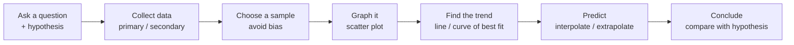

# Chapter 2: Relations

> 📖 Textbook pp. 38–99 · [⬅ Course home](../)

A **relation** describes how two variables are connected, e.g. height and shoe size, or time
and distance. This chapter covers how to collect data fairly, graph it, find trends, and
use those trends to make predictions.

**Chapter problem:** a coach is choosing high jumpers. Which physical factors might affect
jump height? You design an experiment to find out.

## Sections

| # | Section | Pages | Key skill |
|---|---------|-------|-----------|
| 2.1 | [Hypotheses and Sources of Data](2.1-hypotheses-and-data-sources/) | 42–47 | Write a testable hypothesis; primary vs secondary data |
| 2.2 | [Sampling Principles](2.2-sampling-principles/) | 48–55 | Population, sample, random sampling methods, bias |
| 2.3 | [Use Scatter Plots to Analyse Data](2.3-scatter-plots/) | 56–67 | Independent/dependent variables, scatter plots, outliers |
| 2.4 | [Trends, Interpolation, and Extrapolation](2.4-trends-interpolation-extrapolation/) | 68–76 | Describe trends, estimate between/beyond data |
| 2.5 | [Linear and Non-Linear Relations](2.5-linear-and-non-linear-relations/) | 77–87 | Lines and curves of best fit |
| 2.6 | [Distance-Time Graphs](2.6-distance-time-graphs/) | 88–94 | Read and sketch motion graphs |

## Vocabulary
hypothesis · statistics · primary data · secondary data · sample · population · census ·
random sample · simple random sampling · systematic random sampling · stratified random sampling ·
non-random sampling · bias · inference · dependent variable · independent variable · outlier ·
interpolate · extrapolate · linear relation · line of best fit · curve of best fit ·
distance-time graph ([full definitions](../GLOSSARY.md))

## Get Ready refresher (pp. 40–41)
- **Bar graphs** compare amounts across categories (the bar height is the value).
- **Scatter plots** show data with *two* variables as ordered pairs $(x, y)$.
- A **rate** compares quantities in different units. A **unit rate** is per 1 unit:
  $$\frac{348 \text{ km}}{4.0 \text{ h}} = 87 \text{ km/h}$$

## Technology used in this chapter
| Tool | How to make a scatter plot |
|------|---------------------------|
| TI-83/84 | `STAT → 1:Edit` (enter L1, L2) → `2nd STATPLOT → Plot1 On, scatter, Xlist L1, Ylist L2` → `ZOOM 9:ZoomStat` |
| TI-83/84 line of best fit | `STAT → CALC → 4:LinReg(ax+b)`, then `VARS → Y-VARS → 1:Function → Y1` → `GRAPH` |
| Fathom™ | Case table → name columns → graph → drag attributes to axes → *Graph ▸ Least Squares Line* |
| Spreadsheet | Select data → Insert Chart → XY (Scatter) → Add Trendline (Linear) |
| CBR™ rangefinder | `APPS → CBL/CBR → 3:RANGER` to record distance-time graphs |

## Review checklist (Chapter 2 Review & Practice Test, pp. 95–99)
- [ ] I can state a hypothesis and its opposite.
- [ ] I can tell primary from secondary data and give a pro/con of each.
- [ ] I can identify the population and describe simple, systematic and stratified random samples.
- [ ] I can explain how a sample could be biased.
- [ ] I can identify the independent and dependent variables and draw a labelled scatter plot.
- [ ] I can spot outliers and decide whether to keep them.
- [ ] I can describe a trend and interpolate/extrapolate from a graph.
- [ ] I can decide whether a relation is linear or non-linear and draw a line/curve of best fit.
- [ ] I can describe the motion shown by a distance-time graph, and sketch one from a story.
- [ ] I can write up an experiment: objective, hypothesis, procedure, observations, conclusion, evaluation.

---
[⬅ Chapter 1](../01-mathematical-processes/) · [Course home](../) · [Next chapter: Polynomials ➡](../03-polynomials/)
