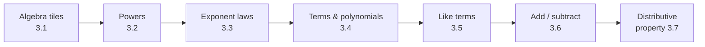

# Chapter 3: Polynomials

> 📖 Textbook pp. 100–181 · [⬅ Course home](../)

Algebra uses letters (variables) to stand for numbers, so you can write ideas like $E = mc^2$
in a few symbols. This chapter goes from algebra-tile models to exponents, the exponent laws,
and then simplifying, adding, subtracting and expanding polynomials.

**Chapter problem:** Alysia designs a letter-E crest whose height is always twice its width.
How can she make it bigger or smaller without changing its proportions? (Algebra: if width $= w$,
then height $= 2w$ and area $= 2w^2$.)

## Sections

| # | Section | Pages | Key skill |
|---|---------|-------|-----------|
| 3.1 | [Build Algebraic Models Using Concrete Materials](3.1-algebraic-models/) | 104–109 | Model length, area and volume with tiles and cubes |
| 3.2 | [Work With Exponents](3.2-exponents/) | 110–118 | Base, exponent, evaluating powers, negative bases |
| 3.3 | [Discover the Exponent Laws](3.3-exponent-laws/) | 119–129 | Product, quotient and power-of-a-power rules |
| 3.4 | [Communicate With Algebra](3.4-communicate-with-algebra/) | 130–139 | Terms, coefficients, classifying polynomials, degree |
| — | *Use Technology: Virtual Algebra Tiles With The Geometer's Sketchpad®* | 140–143 | see [Technology extras](#technology-extras) |
| 3.5 | [Collect Like Terms](3.5-collect-like-terms/) | 144–153 | Identify and combine like terms |
| 3.6 | [Add and Subtract Polynomials](3.6-add-and-subtract-polynomials/) | 154–159 | Remove brackets, subtract by adding the opposite |
| 3.7 | [The Distributive Property](3.7-distributive-property/) | 160–169 | Expand $a(x + y)$; expand and simplify |
| — | *Use Technology: Computer Algebra Systems* | 170–173 | see [Technology extras](#technology-extras) |

Also: Chapter 3 Review (p. 174), Practice Test (p. 176), **Chapters 1 to 3 Review** (p. 178), Tasks (p. 180).

## Vocabulary
variable · algebraic expression · term · coefficient · polynomial · monomial · binomial · trinomial ·
degree of a term · degree of a polynomial · like terms · distributive property · power · base · exponent
([full definitions](../GLOSSARY.md))

## Get Ready refresher (pp. 102–103)
- **Add integers:** opposites add to zero, $(+4) + (-4) = 0$. Use a number line.
- **Subtract integers:** add the opposite. $5 - (-2) = 5 + 2 = 7$
- **Multiply/divide integers:** same signs → $+$; different signs → $-$.
  $(-3)(-4) = 12$, $\; -14 \div 7 = -2$
- **Multiply rational numbers:** multiply numerators, multiply denominators, cancel common factors first; the sign follows the integer rules.
  $$\left(-\frac{3}{4}\right) \times \frac{1}{5} = -\frac{3}{20}$$

## Cheat sheet
| Rule | Formula | Example |
|------|---------|---------|
| Product rule | $x^a \times x^b = x^{a+b}$ | $3^2 \times 3^3 = 3^5$ |
| Quotient rule | $x^a \div x^b = x^{a-b}$ | $8^7 \div 8^5 = 8^2$ |
| Power of a power | $(x^a)^b = x^{ab}$ | $(3^2)^4 = 3^8$ |
| Zero exponent | $x^0 = 1$ ($x \ne 0$) | $\left(\frac{3}{4}\right)^0 = 1$ |
| Collect like terms | add coefficients only | $3x^2 + 5x^2 = 8x^2$ |
| Subtract polynomials | add the opposite | $(a) - (b + c) = a - b - c$ |
| Distributive property | $a(x + y) = ax + ay$ | $3x(x + 2) = 3x^2 + 6x$ |

## Technology extras
**Virtual Algebra Tiles (The Geometer's Sketchpad®, pp. 140–143)**: open *Algebra Tiles.gsp*,
drag tiles to build expressions, and use the $x$-slider to see which tiles change size
(only $x$- and $x^2$-tiles do; unit tiles stay 1 × 1). Good for checking like terms: tiles
that change the same way are like terms.

**Computer Algebra Systems (CAS, pp. 170–173)**: a TI-89 or CAS software can simplify, expand
and evaluate algebra symbolically, e.g. `expand(3x(x+2))` → `3x^2+6x`. Use it to **check**
hand work, not to replace it. Clear the memory first so old variable values don't interfere.

## Review checklist (Chapter 3 Review & Practice Test, pp. 174–177)
- [ ] I can model expressions with algebra tiles and write the expression for a tile model.
- [ ] I can write powers in expanded form and evaluate them, including negative and fraction bases.
- [ ] I know why $(-3)^4 \ne -3^4$.
- [ ] I can apply the product, quotient and power-of-a-power rules, with numbers and variables.
- [ ] I can identify the coefficient and variable part of a term.
- [ ] I can classify a polynomial by number of terms and by degree.
- [ ] I can collect like terms.
- [ ] I can add and subtract polynomials (watch the signs when subtracting!).
- [ ] I can expand using the distributive property, then simplify.

---
[⬅ Chapter 2](../02-relations/) · [Course home](../) · [Next chapter: Equations ➡](../04-equations/)
