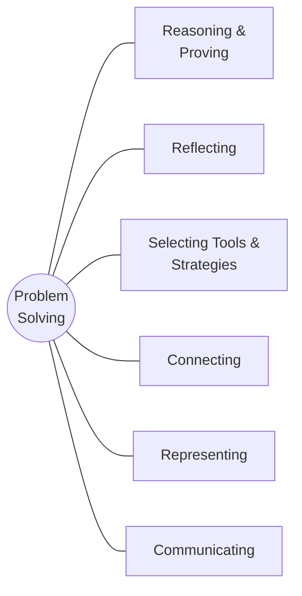

# Strand A: Mathematical Thinking and Making Connections

> [⬅ Course home](../) · 📘 [Ontario MTH1W curriculum](https://www.dcp.edu.gov.on.ca/en/curriculum/secondary-mathematics/courses/mth1w)

This strand isn't a unit. It runs **through the whole course**: the seven mathematical processes, making connections to real life and other cultures (A2), and social-emotional learning skills (AA1). The textbook covers it in **Chapter 1: Mathematical Processes**.

## Overall expectations

- **A1 Mathematical Processes**: apply the mathematical processes to develop a conceptual understanding of, and procedural fluency with, the mathematics they are learning
- **A2 Making Connections**: make connections between mathematics and various knowledge systems, their lived experiences, and various real-life applications of mathematics, including careers
- **AA1 Social-Emotional Learning Skills**: develop and explore a variety of social-emotional learning skills in a context that supports and reflects this learning in connection with the expectations across all other strands

## Topics

| # | Topic | Curriculum | Textbook | Status |
|---|-------|------------|----------|--------|
| 01 | [Problem Solving](01-problem-solving/) | A1 | §1.1, pp. 6–9 | ✅ Notes |
| 02 | [Communicating](02-communicating/) | A1 | §1.2, pp. 10–13 | ✅ Notes |
| 03 | [Connecting](03-connecting/) | A1, A2 | §1.3, pp. 14–18 | ✅ Notes |
| 04 | [Representing](04-representing/) | A1 | §1.4, pp. 19–22 | ✅ Notes |
| 05 | [Selecting Tools and Computational Strategies](05-selecting-tools/) | A1 | §1.5, pp. 23–28 | ✅ Notes |
| 06 | [Reasoning and Proving](06-reasoning-and-proving/) | A1 | §1.6, pp. 29–33 | ✅ Notes |
| 07 | [Reflecting](07-reflecting/) | A1 | §1.7, pp. 34–36 | ✅ Notes |

Specific expectations (the detailed codes like B2.1) are listed on each topic page.

## Problem-solving strategy toolbox
| Strategy | Use it when… |
|----------|--------------|
| Make an organized list / table | You need to count all possibilities without missing any |
| Look for a pattern | Something repeats or grows step by step |
| Work backward | You know the end result and need the start |
| Draw a diagram | The situation is physical or spatial |
| Use systematic trial (guess & check) | There are a few candidates; adjust each guess logically |
| Use logic or reasoning | Clues eliminate possibilities |
| Solve a simpler problem | Numbers are too big; try small cases first |
| Make a model / act it out | Hands-on helps you see it |
| Use a formula | A known relationship applies (area, volume, …) |

## Review checklist
- [ ] I can continue a pattern and describe the rule for successive terms.
- [ ] I can use an organized list to count all possible outcomes.
- [ ] I can estimate the answer to a Fermi problem and state my assumptions.
- [ ] I can prove a simple conjecture with algebra, or disprove it with a counter-example.
- [ ] I can explain *which* strategy I used and *why* it was a good choice.
- [ ] I can connect a math idea to real life, a career, or another culture (A2).

---
[Course home](../) · [Next: Strand B: Number ➡](../B-number/)
