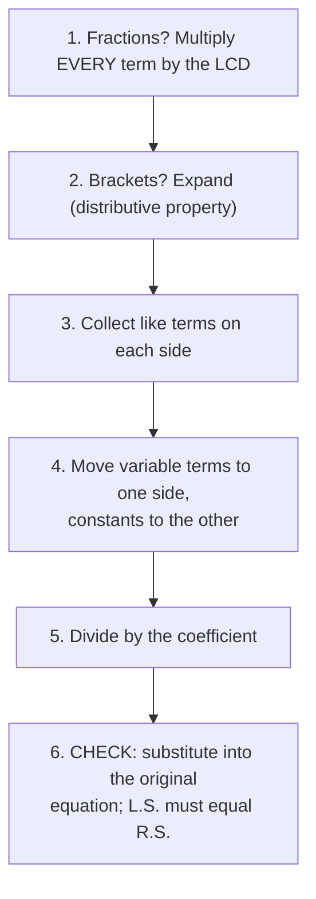

# Solving Equations

> 📘 **Curriculum:** C1.5 · 📖 **Textbook:** Ch. 4, pp. 182–233 · [⬅ Strand C: Algebra](../)

## Big idea
An equation is like a **balance scale**. The equal sign is the middle of the scale, and both sides
weigh the same. To find the unknown, **undo** what was done to it, and **always do the same thing to
both sides** so the scale stays balanced.

$$\underbrace{2x + 7}_{\text{left side (L.S.)}} \;=\; \underbrace{19}_{\text{right side (R.S.)}}$$

## Lessons in this topic

| # | Lesson | Textbook | You'll learn to solve… |
|---|--------|----------|------------------------|
| 1 | [Simple Equations](1-simple-equations.md) | §4.1, pp. 186–195 | $x + 4 = 13$, $\;3y = 18$, $\;5x + 25 = 500$ |
| 2 | [Multi-Step Equations](2-multi-step-equations.md) | §4.2, pp. 196–203 | $3x + 2 = 2x - 4$, $\;5(y - 3) - (y - 2) = 19$ |
| 3 | [Equations With Fractions](3-equations-with-fractions.md) | §4.3, pp. 204–210 | $\frac{k - 2}{3} = \frac{k + 4}{5}$ |
| 4 | [Rearranging Formulas](4-rearranging-formulas.md) | §4.4, pp. 211–219 | $y = mx + b$ for $x$ |
| 5 | [Modelling With Algebra (Word Problems)](5-word-problems.md) | §4.5, pp. 220–229 | "Jerry makes twice as much as Koko…" |
| ✏️ | [**Practice Quiz**](practice-quiz.md) | Review pp. 230–233 | 20 mixed questions with full solutions |

## Vocabulary
| Term | Meaning | Example |
|------|---------|---------|
| **equation** | a math statement that says two expressions are equal | $3x + 3 = 2x - 1$ |
| **solution** / **root** | the value of the variable that makes the equation true | $x = 7$ is the root of $9 = x + 2$ |
| **solve** | find the solution | |
| **isolate** | get the variable by itself on one side | $x = 9$ |
| **constant term** | a term with no variable | in $2x + 5$, the constant is 5 |
| **coefficient** | the number multiplying the variable | in $2x + 5$, the coefficient is 2 |
| **formula** | an equation that relates two or more variables | $A = lw$ |
| **LCD** | lowest common denominator: the smallest number all the denominators divide into | LCD of $\frac{1}{6}$ and $\frac{1}{8}$ is 24 |

## Opposite (inverse) operations
To undo an operation, do its opposite **to both sides**.

| If the equation has… | Undo it by… | Example |
|----------------------|-------------|---------|
| $+\,4$ | subtracting 4 | $x + 4 = 13 \Rightarrow x = 13 - 4 = 9$ |
| $-\,8$ | adding 8 | $x - 8 = 2 \Rightarrow x = 2 + 8 = 10$ |
| $\times\,3$ | dividing by 3 | $3y = 18 \Rightarrow y = 18 \div 3 = 6$ |
| $\div\,3$ | multiplying by 3 | $\frac{n}{3} = 4 \Rightarrow n = 4 \times 3 = 12$ |
| squared | taking the square root | $l^2 = 32 \Rightarrow l = \sqrt{32}$ |

## The recipe that solves every equation in this unit
Not every equation needs every step. Skip the ones that don't apply.

> 💡 **Why this order?** Solving is **BEDMAS in reverse**. Undo adding/subtracting first,
> then undo multiplying/dividing.

### See it once, all six steps
Solve $\dfrac{x + 1}{2} = \dfrac{2(x - 3)}{3} + 1$.

$$
\begin{aligned}
6 \cdot \frac{x + 1}{2} &= 6 \cdot \frac{2(x - 3)}{3} + 6 \cdot 1 && \text{1. multiply every term by the LCD, 6}\\
3(x + 1) &= 4(x - 3) + 6\\
3x + 3 &= 4x - 12 + 6 && \text{2. expand}\\
3x + 3 &= 4x - 6 && \text{3. collect like terms}\\
3 + 6 &= 4x - 3x && \text{4. variables right, constants left}\\
9 &= x && \text{5. (coefficient is already 1)}
\end{aligned}
$$

**6. Check** with $x = 9$: L.S. $= \frac{9 + 1}{2} = 5$. R.S. $= \frac{2(6)}{3} + 1 = 4 + 1 = 5$. L.S. = R.S. ✓

## Quiz-day checklist
- [ ] Show **one equal sign per line**, and line them up.
- [ ] Whatever you do, do it to **both sides**, and to **every term**.
- [ ] A minus sign in front of brackets flips **every** sign inside: $-(y - 2) = -y + 2$.
- [ ] When clearing fractions, multiply the **whole numbers** too.
- [ ] Answers can be negative or fractions. That's fine! Leave fractions in lowest terms.
- [ ] **Check** your answer in the *original* equation.
- [ ] For word problems, answer with a **sentence and units**, and make sure the answer is realistic
      (you can't buy 83.3 T-shirts).

## Watch out (the most common quiz mistakes)
| ❌ Wrong | ✅ Right | Why |
|---------|---------|-----|
| $x + 5 = 12 \Rightarrow x = 17$ | $x = 12 - 5 = 7$ | Undo $+5$ by **subtracting** |
| $-3x = 12 \Rightarrow x = 4$ | $x = 12 \div (-3) = -4$ | Divide by the **whole** coefficient, sign included |
| $5 - (y - 2) = 5 - y - 2$ | $5 - y + 2$ | The minus flips **both** signs |
| $\frac{x}{2} + 3 = 5 \Rightarrow x + 3 = 10$ | $x + 6 = 10$ | Multiply **every** term by 2 |
| $2x = 3x + 4 \Rightarrow -x = 4 \Rightarrow x = 4$ | $x = -4$ | $-x = 4$ means $x = -4$ |

---
[⬅ The Distributive Property](../05-distributive-property/) · [Strand C](../) · [Next: Coding ➡](../07-coding/)
