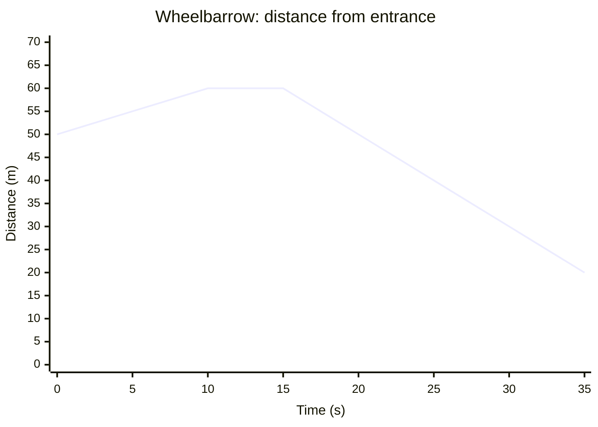

# Distance-Time Graphs

> 📘 **Curriculum:** C3.1 · 📖 **Textbook:** §2.6, pp. 88–94 · [⬅ Strand C: Algebra](../)

## Big idea
A **distance-time graph** tells a motion story. The **direction** of the line says whether you are
moving away, moving closer or standing still, and its **steepness** says how fast.

## Vocabulary
| Term | Meaning |
|------|---------|
| **distance-time graph** | a graph that shows how distance (from a fixed point) varies with time |

## Key concepts
| Shape of graph | Meaning |
|----------------|---------|
| Rising line ↗ | distance increasing: moving **away** from the point |
| Falling line ↘ | distance decreasing: moving **toward** the point |
| Horizontal line → | distance constant: **not moving** |
| Steeper line | **faster** |
| Straight segment | **constant speed** (linear) |
| Curved segment | **changing speed** (speeding up or slowing down) |

- Time is the **independent** variable (horizontal axis); distance is **dependent** (vertical axis).
- A CBR™ (calculator-based rangefinder) measures distance using sound pulses and draws the graph live.
- A falling ball's graph is **curved**, because the ball speeds up as it falls.

## Worked examples

### Example 1: Wheelbarrow at a construction site (sketch from a story)
A worker starts 50 m from the entrance, pushes **away** at 1 m/s for 10 s, stops 5 s to unload,
then comes **back** at 2 m/s for 20 s.

| Time (s) | Distance from entrance (m) | What's happening |
|----------|----------------------------|------------------|
| 0 | 50 | start |
| 10 | $50 + 1(10) = 60$ | moving away (rising) |
| 15 | 60 | stopped (flat) |
| 35 | $60 - 2(20) = 20$ | moving back, faster (steeper fall) |

### Example 2: Read a graph (canoe trip)
A canoeist paddles out from a dock, rests, then paddles back.
- The **highest point** is the far end of the lake (maximum distance).
- The **flat** part is the rest stop.
- Compare **steepness** to find which direction was faster.
- Total trip time is where the graph returns to 0 distance.

## Watch out
- ⚠️ A distance-time graph is **not a picture of the path**. A falling line means "getting closer", not "going downhill".
- ⚠️ A vertical line is impossible: you can't be in two places at the same instant.

## Quick check
1. Sketch the graph: a student walks from home at a steady pace, slows down, stops to mail a letter, then runs home at a constant speed.
2. On a distance-time graph, which segment shows the fastest movement: the steepest one or the longest one?

Answers

1. Straight rising line → curve that flattens (slowing) → horizontal segment (stopped) → steep straight falling line back to distance 0.
2. The **steepest** one. Length doesn't matter; steepness is speed.

---
[⬅ Linear and Non-Linear Relations](../08-linear-and-non-linear-relations/) · [Strand C](../) · [Next: Variation, Slope, and First Differences ➡](../10-variation-slope-first-differences/)
