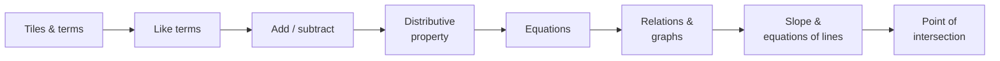

# Strand C: Algebra

> [⬅ Course home](../) · 📘 [Ontario MTH1W curriculum](https://www.dcp.edu.gov.on.ca/en/curriculum/secondary-mathematics/courses/mth1w)

Expressions, equations, coding, and linear and non-linear relations. In the textbook this is spread over **Chapters 2, 3, 4, 5 and 6**.

## Overall expectations

- **C1 Algebraic Expressions and Equations**: demonstrate an understanding of the development and use of algebraic concepts and of their connection to numbers, using various tools and representations
- **C2 Coding**: apply coding skills to represent mathematical concepts and relationships dynamically, and to solve problems, in algebra and across the other strands
- **C3 Application of Relations**: represent and compare linear and non-linear relations that model real-life situations, and use these representations to make predictions
- **C4 Characteristics of Relations**: demonstrate an understanding of the characteristics of various representations of linear and non-linear relations, using tools, including coding when appropriate

## Topics

| # | Topic | Curriculum | Textbook | Status |
|---|-------|------------|----------|--------|
| 01 | [Algebraic Models With Tiles](01-algebraic-models/) | C1.2 | §3.1, pp. 104–109 | ✅ Notes |
| 02 | [Terms and Polynomials](02-terms-and-polynomials/) | C1.2 | §3.4, pp. 130–139 | ✅ Notes |
| 03 | [Collect Like Terms](03-like-terms/) | C1.3, C1.4 | §3.5, pp. 144–153 | ✅ Notes |
| 04 | [Add and Subtract Polynomials](04-add-and-subtract-polynomials/) | C1.3, C1.4 | §3.6, pp. 154–159 | ✅ Notes |
| 05 | [The Distributive Property](05-distributive-property/) | C1.4 | §3.7, pp. 160–169 | ✅ Notes |
| 06 | [Solving Equations](06-solving-equations/) | C1.5 | Ch. 4, pp. 182–233 | ✅ Notes |
| 07 | [Coding](07-coding/) | C2.1, C2.2, C2.3 | not covered | ⚠️ Not in textbook |
| 08 | [Linear and Non-Linear Relations](08-linear-and-non-linear-relations/) | C3.1, C4.1 | §2.5, pp. 77–87 | ✅ Notes |
| 09 | [Distance-Time Graphs](09-distance-time-graphs/) | C3.1 | §2.6, pp. 88–94 | ✅ Notes |
| 10 | [Variation, Slope, and First Differences](10-variation-slope-first-differences/) | C3.2, C4.1, C4.4 | Ch. 5, pp. 234–291 | 📝 Outline |
| 11 | [Equations and Graphs of Lines](11-equations-of-lines/) | C4.2, C4.3, C4.4 | §6.1–6.6, pp. 292–343 | 📝 Outline |
| 12 | [Comparing Linear Relations (Point of Intersection)](12-comparing-linear-relations/) | C3.3 | §6.7, pp. 344–351 | 📝 Outline |

Specific expectations (the detailed codes like B2.1) are listed on each topic page.

## Algebra cheat sheet
| Skill | Rule | Example |
|-------|------|---------|
| Degree of a term | add the exponents of the variables | $7x^2y^4$ has degree 6 |
| Collect like terms | add the coefficients only | $3x^2 + 5x^2 = 8x^2$ |
| Subtract polynomials | add the opposite (flip **every** sign) | $(4y + 7) - (2y - 5) = 2y + 12$ |
| Distributive property | $a(x + y) = ax + ay$ | $3x(x + 2) = 3x^2 + 6x$ |
| Linear test | constant first differences | $y$: −9, −4, 1, 6 → +5 each time |

## Technology extras
- **Virtual algebra tiles** (textbook pp. 140–143, The Geometer's Sketchpad®). Drag tiles to build expressions, then move the $x$-slider: only $x$- and $x^2$-tiles change size. Tiles that change the same way are like terms. Free alternatives: the Desmos or Mathies algebra tiles.
- **Computer Algebra Systems** (textbook pp. 170–173). Use a CAS such as a TI-89, GeoGebra CAS or Desmos to check hand work, e.g. `expand(3x(x+2))` → `3x^2+6x`. Use it to **check**, not to replace, your work.
- **Coding** (C2) isn't in the textbook. Python, Scratch, or Desmos with sliders all work.

## Review checklist
- [ ] I can model expressions with algebra tiles and write the expression for a tile model.
- [ ] I can classify a polynomial by number of terms and by degree.
- [ ] I can collect like terms, add and subtract polynomials, and expand with the distributive property.
- [ ] I can solve and verify multi-step equations (C1.5).
- [ ] I can write and read simple code that models a relation (C2).
- [ ] I can decide whether a relation is linear or non-linear from its graph, table or equation.
- [ ] I can describe the motion shown by a distance-time graph.
- [ ] I can connect rate of change ↔ slope and initial value ↔ $y$-intercept.
- [ ] I can find and interpret the point of intersection of two lines.

---
[⬅ Strand B: Number](../B-number/) · [Course home](../) · [Next: Strand D: Data ➡](../D-data/)
