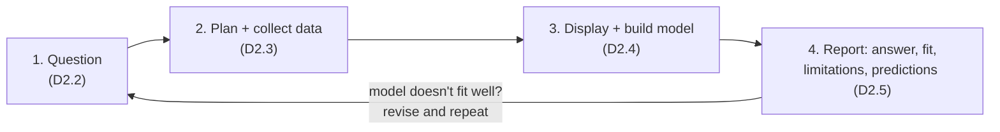

# The Mathematical Modelling Process

> 📘 **Curriculum:** D2.1, D2.2, D2.3, D2.4, D2.5 · 📖 **Textbook:** Ch. 2 Chapter Problem (pp. 39, 47, 66, 99); experiment reports §2.3, §2.5; equations from data §5.1–5.2, §5.5 · [⬅ Strand D: Data](../)

## Big idea
A **mathematical model** is a graph, table or equation that describes a real situation so you can
**understand it and make predictions**. Modelling is a **cycle**: you ask a question, collect data,
build a model, test it, and report what it tells you, then improve it if you need to.



## Vocabulary
| Term | Meaning |
|------|---------|
| **mathematical model** | a description of a real situation using math (a graph, table, equation or diagram) |
| **question of interest** | the real-life question the model is meant to answer |
| **assumption** | something you accept as true to make the problem simpler (e.g. "the trend will continue") |
| **variable** | a quantity that changes in the situation (the independent and dependent variables) |
| **controlled variable** | something you keep the **same** so it doesn't affect the results |
| **limitation** | a reason the model might give wrong answers (small sample, only works in a certain range…) |
| **direct variation** | a linear relation through the origin: $y = kx$ (textbook §5.1) |
| **partial variation** | a linear relation with a starting value: $y = mx + b$, $b \ne 0$ (textbook §5.2) |

## Step by step

### Step 1: The question (D2.1, D2.2)
**Why model?** Models help people make **decisions**: a coach picks athletes, a city plans how much
water it needs in summer, a store decides how many uniforms to order, doctors use growth charts to
judge a baby's health.

A good question of interest is **specific** and **measurable**, and says what information you need.

| ❌ Too vague | ✅ Good question | Information needed |
|-------------|------------------|--------------------|
| "Who's good at high jump?" | "Do students with longer legs jump higher?" | leg length (cm) and best jump height (cm) for several students |
| "Is exercise good?" | "How does heart rate change in the 80 s after 2 min of running?" | pulse every 10 s |

Then write a **hypothesis** and its opposite (see [Hypotheses](../04-hypotheses-and-data-sources/)).

### Step 2: Plan and collect the data (D2.3)
Your plan should answer:
- **Source:** primary (you measure it) or secondary (someone else's data)?
- **Sample:** who or what will you measure, how many, and how will you choose them fairly? (see [Sampling](../05-sampling/))
- **What varies:** the **independent** variable (you change or choose it) and the **dependent** variable (you measure it).
- **What stays the same:** the **controlled** variables, so the test is fair.
- **Assumptions:** what you're taking for granted.

### Step 3: Display the data and build the model (D2.4)
1. Make a **table of values**.
2. Draw a **scatter plot** (independent on the $x$-axis). Title, labels, units.
3. Look at the shape. Is it **linear** or **non-linear**? Is there an **outlier**? (see [Scatter Plots](../02-scatter-plots/))
4. Draw a **line or curve of best fit** (see [Trends](../03-trends-interpolation-extrapolation/#using-a-line-of-best-fit-to-predict)).
5. For a line, **find its equation** (from Chapter 5):

$$\text{slope } m = \frac{\text{rise}}{\text{run}} = \frac{y_2 - y_1}{x_2 - x_1} \qquad\qquad y = mx + b$$

> 💡 Pick two points **on your line** (not necessarily data points), far apart, where the line
> crosses grid lines neatly. Then substitute one point to find $b$.

| If your line… | the model is… | example |
|---|---|---|
| passes through (or very close to) the **origin** | **direct variation** $y = kx$, where $k = \frac{y}{x}$ is about the same for every point | pay $= 7.50 \times$ hours |
| crosses the $y$-axis **above or below 0** | **partial variation** $y = mx + b$ | taxi fare $=$ 3.50 dollars $+$ 2 dollars per km |

6. Or use technology for the **regression** (see the [Strand D tech table](../#technology-for-this-strand)). Try linear and non-linear models and keep the one that fits better.

### Step 4: Report (D2.5)
Your report must say four things:
1. **Answer:** What does the model say about the question? Was the hypothesis supported?
2. **Fit:** How well does the model fit? (Are the points close to the line? Any outliers?)
3. **Limitations:** When could it give wrong answers? (small sample, only valid inside the data range, measurement error, other factors)
4. **Predictions:** Use it to interpolate and, carefully, extrapolate.

### Writing it up as an experiment report (textbook §2.3, §2.5)
| Section | What to write |
|---------|---------------|
| **Objective** | the purpose (your question) |
| **Hypothesis** | what you expect to happen |
| **Procedure** | step-by-step plan: equipment, sample, what you measure, what you keep the same |
| **Observations** | your data table and scatter plot with line/curve of best fit |
| **Conclusion** | your inference. Does the data support the hypothesis? |
| **Evaluation** | did you meet the objective? Sources of error? How could you improve it? |

## Worked examples

### Example 1: The high-jump Chapter Problem, start to finish
*A coach is choosing students for the high jump. What physical characteristic helps?*

**1. Question and hypothesis.** "Do students with longer legs jump higher?"
Hypothesis: *Students with longer legs can jump higher.* Opposite: *Students with longer legs cannot jump higher.*

**2. Plan.**
- **Primary data:** measure 10 volunteers from the gym class.
- **Independent:** leg length (floor to hip, cm). **Dependent:** best of 3 jumps (cm).
- **Controlled:** same bar, same mat, same jumping technique, everyone warms up first, measured on the same day.
- **Assumption:** each student tries their hardest on every jump.

**3. Data and model.** *(Sample class data, made up for this example.)*

| Leg length (cm) | 80 | 84 | 86 | 88 | 90 | 92 | 95 | 97 | 100 | 103 |
|---|---|---|---|---|---|---|---|---|---|---|
| Best jump (cm) | 110 | 118 | 115 | 124 | 128 | 126 | 135 | 138 | 140 | 148 |

```
 Jump (cm)        • = data   · = line of best fit
 150 |                                        • ·
 145 |                                     ···
 140 |                              •  ··•
 135 |                            •·
 130 |                    •  ··
 125 |                 •···  •
 120 |           •  ··
 115 |         ··   •
 110 |    ·•·
     +-----+-----+-----+-----+-----+-----+-----+-- Leg length (cm)
          80    84    88    92    96    100   104
```

The points rise steadily and stay close to a straight line: a **strong positive linear** relation,
with no outliers. A line of best fit passes through about $(80, 110)$ and $(100, 142)$.

$$m = \frac{142 - 110}{100 - 80} = \frac{32}{20} = 1.6$$

Substitute $(80, 110)$ into $J = 1.6L + b$:
$$110 = 1.6(80) + b \;\Rightarrow\; 110 = 128 + b \;\Rightarrow\; b = -18$$

$$\boxed{J = 1.6L - 18}$$

**Meaning of the slope:** each extra 1 cm of leg length goes with about **1.6 cm** more jump height.
(A calculator regression gives $J \approx 1.62L - 20$, almost the same.)

**4. Report.**
- **Answer:** the data **supports** the hypothesis. Longer legs went with higher jumps.
- **Fit:** good. All points are within about 5 cm of the line, roughly balanced above and below.
- **Predictions:** a student with 93 cm legs: $J = 1.6(93) - 18 \approx 131$ cm (interpolation, reliable).
- **Limitations:**
  - Only 10 students from one class, so the sample is small and may not be random.
  - The $b = -18$ makes no sense in real life (leg length 0), so the model only works for leg lengths near 80–103 cm.
  - Extrapolating to 130 cm legs gives 190 cm, which is unrealistic: technique, strength and practice matter too.
  - **Correlation isn't causation.** Taller students might also be older or more practised.

### Example 2: Bouncing ball (direct variation, textbook §5.5 Q9)
| Drop height (cm) | 50 | 100 | 150 | 200 | 250 | 300 |
|---|---|---|---|---|---|---|
| Bounce height (cm) | 41 | 82 | 125 | 166 | 208 | 254 |

**Evidence it's linear:**
- **First differences** (drop height goes up by 50 each time): 41, 43, 41, 42, 46. These are almost constant.
- The scatter plot is close to a straight line.

**Evidence it's direct variation:** the ratio $\frac{\text{bounce}}{\text{drop}}$ is nearly constant
(0.82, 0.82, 0.83, 0.83, 0.83, 0.85), and a drop of 0 gives a bounce of 0.

$$B \approx 0.83D$$

**Predict:** a 400 cm drop → $B \approx 0.83(400) \approx 332$ cm.
**Limitation:** this is an **extrapolation**, and the ratio creeps up for bigger drops. A different ball or floor would change $k$.

### Example 3: Interpolate with the equation instead of the graph (textbook §5.1)
Amir earns 7.50 dollars per hour, so $P = 7.50t$.
Reading the graph at $t = 9$ gives **about** 68 dollars. The equation gives the **exact** answer:
$P = 7.50(9) = 67.50$ dollars. **Equations are more precise than reading a graph.**

## Watch out
- ⚠️ Don't skip **controlled variables**. If some students jump in running shoes and others in socks, your data isn't fair.
- ⚠️ When finding the slope of a line of best fit, use points **on the line**, not two random data points.
- ⚠️ Always check whether $b$ (the starting value) makes sense in the real situation.
- ⚠️ "The model fits well" doesn't mean it's true everywhere. State the **range** where it works.
- ⚠️ A report without **limitations** is missing a quarter of the marks.

## Quick check
A student wants to know how the number of pennies dropped into a graduated cylinder affects the water level (textbook §2.5 Q9).

1. Identify the independent, dependent and two controlled variables.
2. State a hypothesis.
3. The data: 0 pennies → 50.0 mL, 10 → 53.5 mL, 20 → 57.0 mL, 30 → 60.5 mL. Find the equation of the line.
4. Is this direct or partial variation? Explain.
5. Predict the level with 45 pennies. Is this interpolation or extrapolation?
6. Give one limitation of the model.

<details><summary>Answers</summary>

1. Independent: number of pennies. Dependent: water level (mL). Controlled: same cylinder, same starting amount of water, same kind of pennies, reading the level at eye height.
2. "Each penny raises the water level by the same amount" (a linear relation).
3. $m = \frac{53.5 - 50.0}{10 - 0} = 0.35$ mL per penny, and $b = 50.0$. **$V = 0.35n + 50$**
4. **Partial variation.** The line starts at 50 mL (not 0), because the water was already there.
5. $V = 0.35(45) + 50 = 65.75 \approx 65.8$ mL. **Extrapolation** (45 is beyond the data, which stops at 30).
6. Any one: the cylinder could overflow; older and newer pennies have different volumes; reading the scale has errors of about ±0.5 mL; only 4 data points.

</details>

---
[⬅ Sampling Principles](../05-sampling/) · [Strand D](../) · [Practice Quiz ✏️](../practice-quiz.md)
