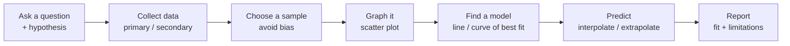

# Strand D: Data

> [⬅ Course home](../) · 📘 [Ontario MTH1W curriculum](https://www.dcp.edu.gov.on.ca/en/curriculum/secondary-mathematics/courses/mth1w)

Collecting, displaying and analysing data with one and two variables, and using data in the **mathematical modelling** process. In the textbook this is mostly **Chapter 2: Relations**.

## Overall expectations

- **D1 Collection, Representation, and Analysis of Data**: describe the collection and use of data, and represent and analyse data involving one and two variables
- **D2 Mathematical Modelling**: apply the process of mathematical modelling, using data and mathematical concepts from other strands, to represent, analyse, make predictions, and provide insight into real-life situations

## Topics

| # | Topic | Curriculum | Textbook | Status |
|---|-------|------------|----------|--------|
| 01 | [Data in the Real World and One-Variable Data](01-one-variable-data/) | D1.1, D1.2 | not covered | ⚠️ Not in textbook |
| 02 | [Scatter Plots and Correlation](02-scatter-plots/) | D1.3 | §2.3, pp. 56–67 | ✅ Notes |
| 03 | [Trends, Interpolation, and Extrapolation](03-trends-interpolation-extrapolation/) | D1.3 | §2.4, pp. 68–76 | ✅ Notes |
| 04 | [Hypotheses and Sources of Data](04-hypotheses-and-data-sources/) | D2.2, D2.3 | §2.1, pp. 42–47 | ✅ Notes |
| 05 | [Sampling Principles](05-sampling/) | D2.3 | §2.2, pp. 48–55 | ✅ Notes |
| 06 | [The Mathematical Modelling Process](06-mathematical-modelling/) | D2.1, D2.2, D2.3, D2.4, D2.5 | Ch. 2 Chapter Problem, pp. 39, 99 | 📝 Outline |

Specific expectations (the detailed codes like B2.1) are listed on each topic page.

## Technology for this strand
| Tool | How to make a scatter plot |
|------|---------------------------|
| Desmos | Add a table, enter $x_1$, $y_1$; regression: `y1 ~ m x1 + b` |
| TI-83/84 | `STAT → 1:Edit` (enter L1, L2) → `2nd STATPLOT → Plot1 On, scatter` → `ZOOM 9:ZoomStat` |
| TI-83/84 line of best fit | `STAT → CALC → 4:LinReg(ax+b)`, then `VARS → Y-VARS → 1:Function → Y1` → `GRAPH` |
| Spreadsheet | Select data → Insert Chart → XY (Scatter) → Add Trendline |
| Fathom™ (textbook) | Case table → graph → drag attributes to axes → *Graph ▸ Least Squares Line* |

## Review checklist
- [ ] I can describe how a large data set is collected and used, and its consequences (D1.1).
- [ ] I can find the mean, median, quartiles and IQR, and draw a box plot (D1.2).
- [ ] I can draw a scatter plot, describe the correlation, and test linear vs. non-linear models (D1.3).
- [ ] I can interpolate and extrapolate, and explain when a prediction is unreliable.
- [ ] I can state a hypothesis and tell primary from secondary data.
- [ ] I can describe simple, systematic and stratified random sampling, and explain bias.
- [ ] I can carry out the whole modelling process and report the model's limitations (D2).

---
[⬅ Strand C: Algebra](../C-algebra/) · [Course home](../) · [Next: Strand E: Geometry and Measurement ➡](../E-geometry-and-measurement/)
